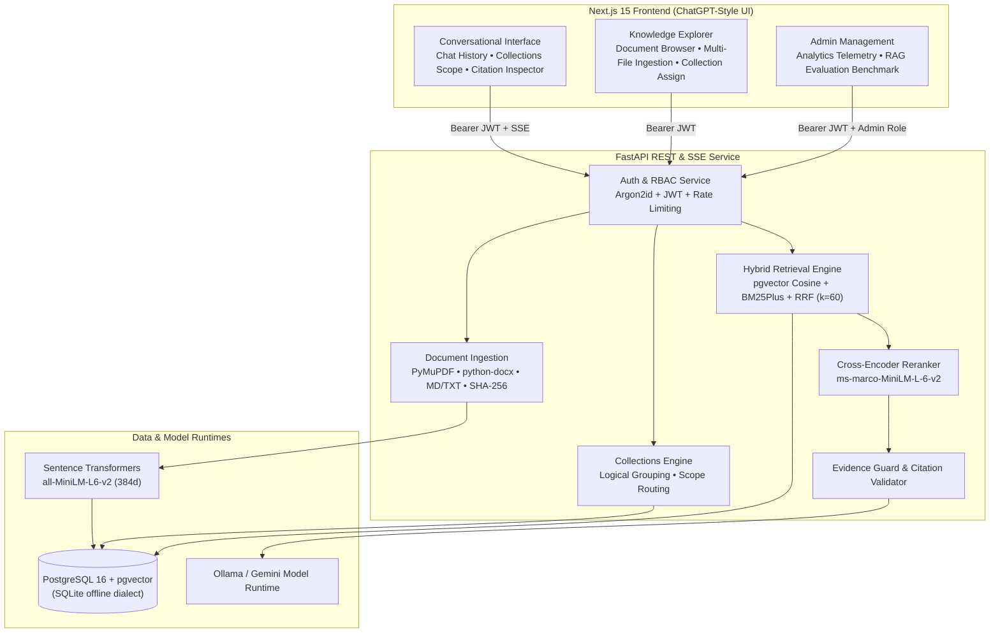

# KnowBase AI — Your Knowledge. One Intelligent Assistant.

<p align="center">
  
  
  
  
  
</p>

<p align="center">
  <a href="https://sacred-rip-would-noted.trycloudflare.com" target="_blank">
    
  </a>
</p>

> 🌐 **Interactive Live Demo:** [https://sacred-rip-would-noted.trycloudflare.com](https://sacred-rip-would-noted.trycloudflare.com)  
> *Pre-seeded Demo Accounts:* **Employee** (`employee@novatech-demo.internal` / `EmployeeDemo!2026`) • **Admin** (`admin@novatech-demo.internal` / `AdminDemo!2026`)

**KnowBase AI** is an enterprise-grade AI Knowledge Assistant powered by **Hybrid Retrieval-Augmented Generation (RAG)**. It allows organisations to index internal documentation across multiple domains (IT Troubleshooting, Company Policies, SOPs, HR Benefits, and Technical Documentation) and interact with them through a modern, ChatGPT-style conversational interface.

Every generated answer is **strictly grounded in authorized internal documentation**, accompanied by **clickable citations and verbatim passage excerpts**, organized into **Knowledge Collections**, protected by **server-side Role-Based Access Control (RBAC)**, and verified through **quantitative retrieval evaluation benchmarks**.

> **Grounding Principle:** The assistant answers exclusively using factual evidence present in authorized internal documents. When retrieved evidence is insufficient, it acknowledges the limitation clearly rather than inventing procedures, commands, or citations.

---

## 🌟 Key Features

### 💬 ChatGPT-Style Conversational Main Experience
- **Modern Conversational Layout**: Collapsible left sidebar containing full conversation history, live conversation search, and New Chat action.
- **Rich Message Composer**: Multiline input support (`Enter` to send, `Shift + Enter` for new lines) with streaming AI responses.
- **Formatted Responses**: Complete Markdown support including syntax-highlighted code blocks, tables, callouts, and numbered procedural lists.
- **Message Utility Controls**: One-click **Copy Answer**, **Regenerate Response**, and **Helpful / Not Helpful Feedback**.
- **Adaptive Themes**: Seamless Light and Dark mode support with automatic system preference detection.

### 📚 Knowledge Collections & Domain Scoping
- **Logical Document Organization**: Group documents into custom collections such as *IT Support & Troubleshooting*, *Policies & Procedures*, *HR & Benefits*, or *Technical Documentation*.
- **Collection-Scoped Chat**: Select a specific collection in the top bar to prioritize retrieval, or search across all authorized organizational knowledge simultaneously.
- **Server-Side Enforcement**: Collection filtering operates on top of server-side document permissions.

### 🔍 Production-Grade Hybrid RAG Pipeline
- **Dense Semantic Retrieval**: Cosine similarity search over 384-dimensional chunk embeddings generated via Sentence Transformers (`all-MiniLM-L6-v2`).
- **Sparse BM25 Keyword Retrieval**: Lexical search via `BM25Plus` preserving domain-specific identifiers (error codes like `VPN-403`, hostnames, CLI flags).
- **Reciprocal Rank Fusion (RRF)**: Merges dense and sparse result ranks ($k=60$) with tunable semantic and lexical weighting.
- **Cross-Encoder Reranking**: Re-scores top candidates using `ms-marco-MiniLM-L-6-v2` for token-level passage-to-query attention.

### 🏷️ Verifiable Source Citations & Passage Inspector
- **Zero Fabricated Citations**: In-flight citation validator cross-checks all references against actual prompt chunks.
- **Source Passage Inspector**: Clicking an inline `[Source N]` badge slides open an inspection drawer showing:
  - Document Title and original filename.
  - Page number (or section/chunk reference).
  - Verbatim retrieved passage excerpt.
  - Relevance confidence score.

### 🛡️ Enterprise Security & Prompt Injection Defense
- **Server-Side Access Control (RBAC)**: User roles (`employee`, `it_staff`, `admin`) map to document classifications (`public`, `employee`, `it_only`, `restricted`). Permissions are enforced inside database queries **before** retrieval, reranking, or LLM context construction.
- **Prompt Injection Defense**: Retrieved document text is treated as untrusted data, enclosed in explicit XML delimiters (`<document_chunk>`), with strict instructions preventing the LLM from following embedded instructions.
- **Non-LLM Evidence Sufficiency Guard**: Evaluates top retrieval scores against similarity thresholds to abstain gracefully before invoking the LLM when no relevant evidence exists.

### ⚡ Dual AI Execution Modes
- **Local AI (Default)**: Fully on-premise, zero-cost inference using **Ollama** (`qwen2.5:0.5b`, `qwen2.5:1.5b`, or `llama3.2:3b`) with automated memory pressure handling.
- **Cloud AI (Optional)**: High-throughput cloud inference using **Google Gemini** (`gemini-2.5-flash`) configured simply via an environment variable.

---

## 🏛️ System Architecture



---

## 🔬 Retrieval Benchmark Evaluation

Evaluated across the benchmark dataset of technical and organizational queries using `backend/scripts/run_evaluation.py`:

| Retrieval Mode | Recall@5 | Precision@5 | MRR | Context Relevance |
| :--- | :---: | :---: | :---: | :---: |
| **Semantic Only** (`all-MiniLM-L6-v2`) | 1.0000 | 0.6767 | 0.9917 | 0.9889 |
| **Hybrid** (`Semantic + BM25Plus + RRF`) | 0.9833 | 0.6867 | 0.9750 | 0.9722 |
| **Hybrid + Cross-Encoder Reranking** | **1.0000** | **0.6400** | **1.0000** | **1.0000** |

- **Exact Identifier Recovery**: Hybrid search and reranking solve vector search drop-offs on specific error codes (e.g. `VPN-403`, `0x8004de40`, `ERR_TUNNEL_CONNECTION_FAILED`).
- **Mean Reciprocal Rank (MRR)**: Cross-Encoder reranking achieves **1.0000 MRR**, ensuring the single most relevant passage is placed in the top rank.

---

## 🛠️ Technology Stack

| Layer | Technologies |
| :--- | :--- |
| **Frontend** | Next.js 15 (App Router), React 19, TypeScript, Tailwind CSS, Lucide Icons, `react-markdown`, `remark-gfm` |
| **Backend** | Python 3.10+, FastAPI, Pydantic v2, SQLAlchemy 2.0, Alembic, `slowapi`, `argon2-cffi`, `PyJWT`, `httpx` |
| **AI & Retrieval** | Sentence Transformers (`all-MiniLM-L6-v2`), `rank-bm25`, CrossEncoder (`ms-marco-MiniLM-L-6-v2`), Ollama, Google Gemini |
| **Document Processing** | PyMuPDF (`fitz`), `python-docx`, UTF-8 Markdown & TXT parsers |
| **Database & Vector** | PostgreSQL 16 with `pgvector` (HNSW indexing), SQLite (zero-config offline dialect) |
| **Infrastructure** | Multi-stage Dockerfiles, Docker Compose |

---

## 🚀 Quickstart Guide

### Prerequisites
- **Node.js 18+** and **npm**
- **Python 3.10+**
- **Ollama** (for local AI) or a **Google Gemini API Key** (for cloud AI)

### 1. Clone the Repository
```bash
git clone https://github.com/Kazuhaxxx/KnowBase-AI.git
cd KnowBase-AI
```

### 2. Configure Environment
Copy the sample environment file:
```bash
cp .env.example .env
```
Key configuration options in `.env`:
```ini
# AI Engine: "local" (Ollama) or "cloud" (Google Gemini)
AI_EXECUTION_MODE=local
OLLAMA_BASE_URL=http://localhost:11434
OLLAMA_MODEL=qwen2.5:0.5b

# Optional: Cloud Mode
# AI_EXECUTION_MODE=cloud
# GEMINI_API_KEY=your_gemini_api_key
# GEMINI_MODEL=gemini-2.5-flash
```

### 3. Backend Setup
```bash
cd backend
python -m venv .venv

# Activate virtual environment:
# Windows:
.venv\Scripts\activate
# Linux/macOS:
source .venv/bin/activate

pip install -r requirements.txt
uvicorn app.main:app --host 127.0.0.1 --port 8000 --reload
```
API Documentation and interactive Swagger UI will be available at `http://127.0.0.1:8000/docs`.

### 4. Frontend Setup
```bash
cd frontend
npm install
npm run dev
```
Open **[http://localhost:3000](http://localhost:3000)** in your browser.

---

## 👥 Seed Demo Credentials

The local database automatically seeds 3 role-tiered accounts:

| Role | Email | Password | Access Level |
| :--- | :--- | :--- | :--- |
| **Admin** | `admin@novatech-demo.internal` | `AdminDemo!2026` | Full Access (Documents, Collections, Evaluation, Telemetry) |
| **IT Specialist** | `itstaff@novatech-demo.internal` | `ItStaffDemo!2026` | IT & Employee Documents (`it_only`, `employee`, `public`) |
| **Employee** | `employee@novatech-demo.internal` | `EmployeeDemo!2026` | General Knowledge & Policies (`employee`, `public`) |

---

## 🧪 Verification & Testing

Run the automated test and evaluation suite:

```bash
# Backend unit & integration test suite (11 tests)
pytest backend/tests -v

# Quantitative RAG benchmark evaluation
python backend/scripts/run_evaluation.py

# Frontend TypeScript check and Linting
npm --prefix frontend run typecheck
npm --prefix frontend run lint
```

---

## 📂 Repository Structure

```
KnowBase-AI/
├── backend/
│   ├── app/
│   │   ├── api/            # REST endpoints (chat, documents, collections, admin)
│   │   ├── core/           # Configuration, security, RBAC dependencies
│   │   ├── models/         # SQLAlchemy ORM models (Document, Chunk, Collection, User)
│   │   ├── schemas/        # Pydantic v2 validation schemas
│   │   └── services/       # Ingestion, Embeddings, Retrieval, Reranking, Generation
│   ├── scripts/            # RAG evaluation and database seeding scripts
│   └── tests/              # Unit and integration test suite
├── frontend/
│   ├── app/                # Next.js 15 App Router pages (chat, knowledge, admin)
│   ├── components/         # ChatInterface, CitationDrawer, KnowledgeBase, Layout
│   ├── hooks/              # Auth, Theme, and Custom UI hooks
│   └── services/           # Typed API and SSE streaming clients
├── data/
│   ├── evaluation/         # 60-question ground-truth evaluation benchmark
│   └── sample_documents/   # Synthetic multi-domain knowledge base
├── database/migrations/    # Alembic database migration scripts
├── docs/                   # Architecture, RAG Pipeline, Security, and API docs
└── infrastructure/docker/  # Multi-stage production Dockerfiles
```

---

## 📄 License
MIT License. Built for enterprise knowledge management and AI-assisted troubleshooting.
