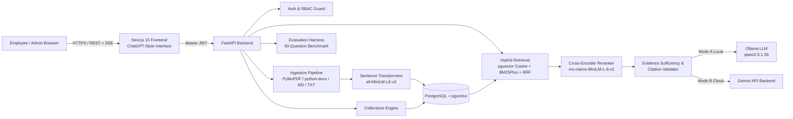

# System Architecture — KnowBase AI
**Tagline:** Your Knowledge. One Intelligent Assistant.

## High-Level Component Architecture

## Module Responsibilities
- **`frontend/`**: Next.js 15 App Router UI providing the ChatGPT-Style Main Experience (Collapsible Chat History, New Chat, Conversation Search, Dynamic Collections Scope Filter, Inline Citation Drawer, Light/Dark themes), Knowledge Base Explorer (Multi-File Ingestion, Collection Assignment), and Administrator Tools (Overview, Telemetry Analytics, RAG Evaluation, System Config).
- **`backend/app/api/`**: Rate-limited, schema-validated REST & SSE endpoints protected by JWT authentication and server-side role dependencies, including `/api/collections`, `/api/chat`, `/api/documents`, and `/api/knowledge`.
- **`backend/app/services/ingestion/`**: Format-specific extraction (PDF, DOCX, TXT, MD), SHA-256 deduplication, version replacement, text cleaning, prompt-injection inspection, and structure-aware chunking.
- **`backend/app/services/embeddings/`**: Unified Sentence Transformers embedding service (`all-MiniLM-L6-v2`, 384d) guaranteeing document chunks and queries share the exact same model and vector space.
- **`backend/app/services/retrieval/`**: Strict RBAC-filtered semantic search, BM25Plus lexical retrieval, weighted Reciprocal Rank Fusion (RRF, $k=60$), multi-domain query expansion, and collection-scoped filtering.
- **`backend/app/services/reranking/`**: Cross-encoder passage reranker (`ms-marco-MiniLM-L-6-v2`) with explicit fallback to RRF ranking when disabled or unavailable.
- **`backend/app/services/generation/`**: Provider abstraction (`OllamaProvider` / `GeminiProvider`), prompt-injection-resistant context framing (`<retrieved_document>` untrusted data), deterministic evidence sufficiency checks, and in-flight citation validation.
- **`backend/app/services/evaluation/`**: Quantitative retrieval evaluation (Recall@K, Precision@K, MRR, Context Relevance) across `semantic`, `hybrid`, and `hybrid_rerank` modes.
